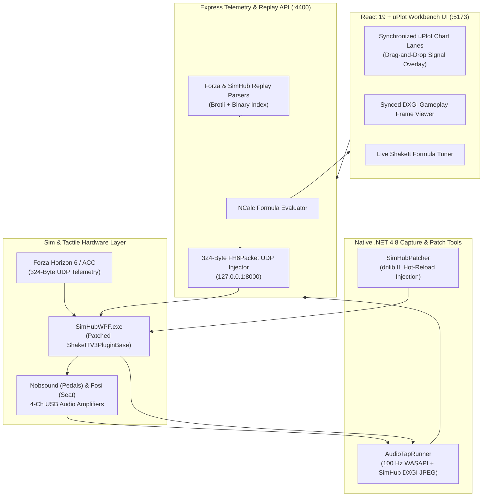
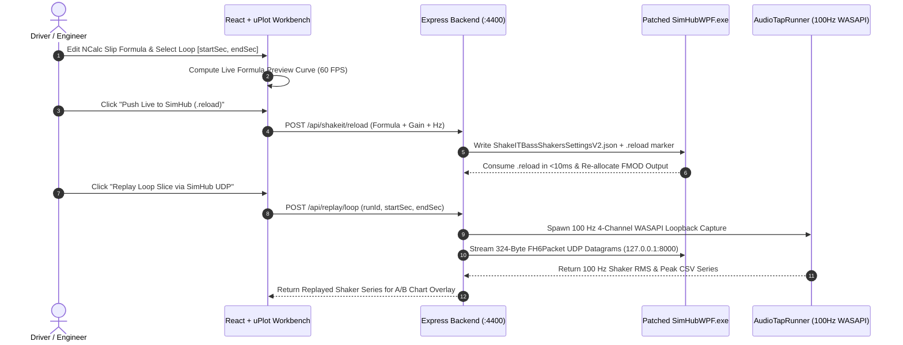

# 🏛️ Architecture: SimTelemetryWorkbench

This document details the architecture, module boundaries, data flows, and deterministic test guarantees of **SimTelemetryWorkbench**.

---

## 🏗️ High-Level System Architecture



---

## 📡 Closed-Loop Tuning & Replay Sequence Flow



---

## 🧩 Modular Boundaries & Directory Structure

```text
├── src/
│   ├── shared/           # Forza 324B packet codec, SimHub Brotli replay parser, NCalc evaluator
│   ├── server/           # Express REST API (/health, /api/runs, /api/shakeit/reload, /api/replay/loop)
│   └── client/           # React 19 + uPlot synchronized multi-lane workbench UI & Zustand store
├── tools/
│   ├── SimHubPatcher/    # dnlib IL injector for zero-restart ShakeIt settings hot-reload
│   └── AudioTapRunner/   # 100 Hz WASAPI loopback + SimHub.ScreenCapture.dll DXGI recorder
├── scripts/              # Git Flow release automation and verify_release.py integrity engine
└── docs/                 # VitePress living documentation site
```

---

## 📐 Non-Functional Requirements & Design Guarantees

1. **Sub-10ms Config Reload**: Patched `SimHub.Plugins.dll` detects `.reload` marker files on the next 60 Hz update tick without process restart.
2. **100 Hz Tactile Resolution**: `AudioTapRunner` aggregates 4-channel WASAPI loopback float samples in 10 ms windows to resolve 44–58 Hz carrier bursts.
3. **Deterministic Closed-Loop Replay**: Any recorded telemetry slice re-encodes into bit-exact 324-byte `FH6Packet` UDP datagrams for repeatable A/B shaker verification.
4. **Anti-Test Theatre Verification**: Automated tests exercise real binary packet roundtrips, real Brotli replay buffers, and real HTTP pipeline requests with 6-part diagnostic feedback envelopes.
