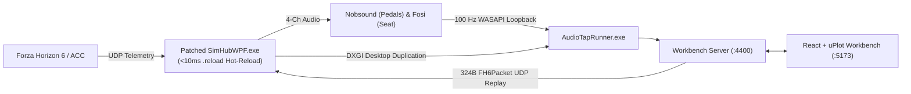

# 🏎️ SimTelemetryWorkbench

[](https://github.com/spelech/SimTelemetryWorkbench/actions/workflows/ci.yml)
[](https://github.com/spelech/SimTelemetryWorkbench/actions/workflows/release.yml)
[](LICENSE)

Scientific telemetry visualization, 100 Hz 4-channel WASAPI bass-shaker loopback analyzer, closed-loop UDP replay injector, and zero-restart SimHub ShakeIt formula tuner for **Forza Horizon 6 (FH6)** and **Assetto Corsa Competizione (ACC)**.

---

## 🏗️ System Architecture



---

## ✨ Key Capabilities

1. **Zero-Restart SimHub Config Hot-Reload (`tools/SimHubPatcher`)**:
   - Uses `dnlib` to inject a `.reload` marker watcher into `ShakeITV3PluginBase.DataUpdate` inside `SimHub.Plugins.dll` and regenerates the module `Mvid` so `.NET Framework 4.8` bypasses stale NGen cache images.
   - Reloads `ShakeITBassShakersSettingsV2.json` and re-allocates FMOD audio outputs in **< 10 ms** without restarting SimHub.
2. **100 Hz 4-Channel WASAPI + SimHub DXGI Capture (`tools/AudioTapRunner`)**:
   - Links directly against SimHub's `NAudio.Wasapi.dll` and `SimHub.ScreenCapture.dll` (`ScreenCaptureFactory.Instance.CreateJpegCapture`).
   - Captures 10 ms RMS & Peak buckets for **Brake Pedal (`Nobsound Ch0`)**, **Throttle Pedal (`Nobsound Ch1`)**, **Seat Left (`Fosi Ch0`)**, and **Seat Right (`Fosi Ch1`)** alongside synced DXGI gameplay frames.
3. **Interactive Drag-and-Drop `uPlot` Workbench (`src/client`)**:
   - Drag any telemetry, slip ratio, combined slip, G-load, or shaker RMS channel onto any chart lane to overlay streams or create new lanes.
   - Edit ShakeIt NCalc formulas with real-time 60 FPS curve previews (`Formula.ThrottlePreview`, `Formula.BrakePreview`) and replay any `[startSec, endSec]` loop slice back through SimHub over UDP port `8000`.

---

## 🚀 Quick Start

```bash
# Install dependencies
npm install

# Run ESLint, TypeScript check, and Vitest unit + simulation harness suites
npm run lint
npx tsc --noEmit
npm test

# Start the Backend (:4400) and Vite Workbench UI (:5173)
npm run dev
```

---

## 📚 Documentation

- [Architecture Specification](ARCHITECTURE.md)
- [Software Requirements & Traceability](REQUIREMENTS.md)
- [Agent Guidelines](AGENTS.md)
- [Changelog](CHANGELOG.md)
